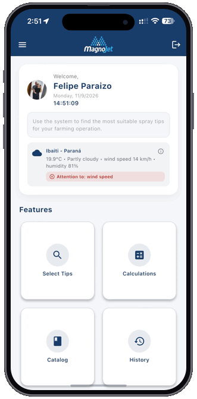
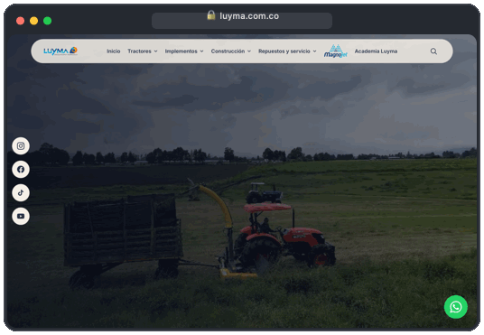

  <a href="./README.md">🇺🇸 EN</a> &nbsp;•&nbsp; <a href="./README-PT.md">🇧🇷 PT</a> &nbsp;•&nbsp; <b>🇪🇸 ES</b>

# Felipe Paraizo  
### Full Stack, Mobile & AI Engineer

Impulsando la tecnología como motor de crecimiento, construyendo sistemas escalables, productos móviles y aplicaciones basadas en IA.

---

<table>
  <tr>
    <td width="260" align="center" valign="middle">
      
    </td>
    <td valign="middle">
      <h3>📱 Aplicación Magnojet &nbsp;</h3>
      

        Plataforma móvil oficial desarrollada para <strong>Magnojet</strong> para asistir a consultores agrícolas y productores en la selección de boquillas de pulverización, cálculos operativos en campo y monitoreo climático en tiempo real a nivel global.
      

      

        
        
      

      

        
<b>Arquitectura Técnica & Especificaciones</b>

         
        
          • <b>Motor de Selección y Cálculo de Precisión:</b> Recomendación inteligente de boquillas, caudal, tasa de aplicación y espectro de gotas 
          • <b>Telemetría Agroclimática en Vivo:</b> Geolocalización y análisis microclimático en tiempo real para prevención de deriva 
          • <b>Motor Multirregión:</b> Soporte nativo para <code>ES</code>, <code>EN</code> y <code>PT-BR</code> con conversión dinámica entre unidades Métricas e Imperiales (EE. UU.) 
          • <b>Multiplataforma Nativo:</b> Desarrollado con Flutter, Dart, Swift y Kotlin
        
      

    </td>
  </tr>
  <tr>
    <td width="260" align="center" valign="middle">
      
    </td>
    <td valign="middle">
      <h3>💻 Luyma S.A. &nbsp;</h3>
      

        Plataforma web oficial desarrollada para <strong>Luyma</strong> en Colombia, presentando maquinaria pesada agrícola y de construcción con un catálogo dinámico de productos, ecosistema de marcas y panel administrativo (CMS) propio.
      

      

        
      

      

        
<b>Arquitectura Técnica & Especificaciones</b>

         
        
          • <b>Arquitectura Web Moderna:</b> Plataforma SSR construida con Next.js (App Router), React 19 y TypeScript 
          • <b>CMS Administrativo & Catálogo Dinámico:</b> Gestión completa de tractores, implementos, equipos de construcción y contenido multimedia 
          • <b>Rendimiento & SEO Optimizado:</b> Sistema de diseño responsivo en Tailwind CSS optimizado para carga rápida y conversión comercial
        
      

    </td>
  </tr>
</table>
