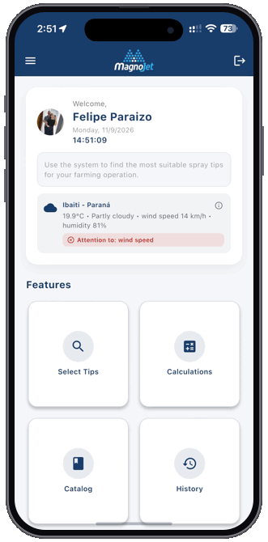

  <a href="./README.md">🇺🇸 English</a>

# Felipe Paraizo  
### Full Stack, Mobile & AI Engineer

Liderando tecnologia como motor de crescimento no **Grupo Veronez**, construindo sistemas escaláveis, produtos mobile e aplicações com IA.

  
  
  

---

<table>
  <tr>
    <td width="240" align="center" valign="middle">
      
    </td>
    <td valign="middle">
      <h3>
        📱 Aplicativo Magnojet
        &nbsp;
        
      </h3>
      

        Plataforma mobile oficial desenvolvida para a <strong>Magnojet</strong> para auxiliar consultores agrícolas e produtores na seleção de pontas de pulverização, cálculos operacionais em campo e monitoramento climático em tempo real globalmente.
      

      

        
        
      

      

        
<b>Arquitetura Técnica & Especificações</b>

         
        
          • <b>Motor de Seleção e Cálculos de Precisão:</b> Recomendação inteligente de pontas, vazão, taxa de aplicação e espectro de gotas 
          • <b>Telemetria Agro-Climática:</b> Geolocalização e análise microclimática em tempo real para prevenção de deriva 
          • <b>Motor Multi-Região:</b> Suporte nativo a <code>PT-BR</code>, <code>EN</code> e <code>ES</code> com conversão entre unidades Métricas e Imperiais (EUA) 
          • <b>Multiplataforma Nativo:</b> Desenvolvido com Flutter, Dart, Swift e Kotlin
        
      

    </td>
  </tr>
</table>
