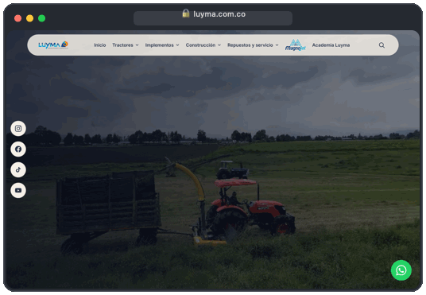

  <a href="./README.md">🇺🇸 EN</a> &nbsp;•&nbsp; <b>🇧🇷 PT</b> &nbsp;•&nbsp; <a href="./README-ES.md">🇪🇸 ES</a>

# Felipe Paraizo  
### Full Stack, Mobile & AI Engineer

Liderando tecnologia como motor de crescimento, construindo sistemas escaláveis, produtos mobile e aplicações com IA.

---

<table>
  <tr>
    <td width="260" align="center" valign="middle">
      
    </td>
    <td valign="middle">
      <h3>📱 Aplicativo Magnojet &nbsp;</h3>
      

        Plataforma mobile oficial desenvolvida para a <strong>Magnojet</strong> para auxiliar consultores agrícolas e produtores na seleção de pontas de pulverização, cálculos operacionais em campo e monitoramento climático em tempo real globalmente.
      

      

        
        
      

      

        
<b>Arquitetura Técnica & Especificações</b>

         
        
          • <b>Motor de Seleção e Cálculos de Precisão:</b> Recomendação inteligente de pontas, vazão, taxa de aplicação e espectro de gotas 
          • <b>Telemetria Agro-Climática:</b> Geolocalização e análise microclimática em tempo real para prevenção de deriva 
          • <b>Motor Multi-Região:</b> Suporte nativo a <code>PT-BR</code>, <code>EN</code> e <code>ES</code> com conversão entre unidades Métricas e Imperiais (EUA) 
          • <b>Multiplataforma Nativo:</b> Desenvolvido com Flutter, Dart, Swift e Kotlin
        
      

    </td>
  </tr>
  <tr>
    <td width="260" align="center" valign="middle">
      
    </td>
    <td valign="middle">
      <h3>💻 Luyma S.A. &nbsp;</h3>
      

        Plataforma web oficial desenvolvida para a <strong>Luyma</strong> na Colômbia, apresentando maquinário pesado agrícola e de construção com catálogo dinâmico de produtos, ecossistema de marcas e painel administrativo (CMS) próprio.
      

      

        
      

      

        
<b>Arquitetura Técnica & Especificações</b>

         
        
          • <b>Arquitetura Web Moderna:</b> Plataforma SSR construída com Next.js (App Router), React 19 e TypeScript 
          • <b>CMS Administrativo & Catálogo Dinâmico:</b> Gestão completa de tratores, implementos, equipamentos de construção e mídia 
          • <b>Performance & SEO:</b> Design system responsivo em Tailwind CSS otimizado para carregamento rápido e conversão comercial
        
      

    </td>
  </tr>
</table>
