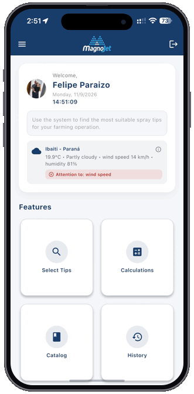

  <a href="./README-PT.md">🇧🇷 Português</a>

# Felipe Paraizo  
### Full Stack, Mobile & AI Engineer

Driving technology as a growth engine at **Grupo Veronez**, building scalable systems, mobile products, and AI-driven applications.

---

<table>
  <tr>
    <td width="240" align="center" valign="middle">
      
    </td>
    <td valign="middle">
      <h3>📱 Magnojet Application &nbsp;</h3>
      

        Official mobile platform developed for <strong>Magnojet</strong> to assist agricultural consultants and producers in selecting spray tips, calculating field application parameters, and monitoring real-time weather conditions globally.
      

      

        
        
      

      

        
<b>Technical Architecture & Specs</b>

         
        
          • <b>Smart Selection & Calculation Engine:</b> Precision nozzle recommendation, flow rate, application rate, and droplet spectrum modeling 
          • <b>Live Agro-Meteorology:</b> Geolocation & real-time microclimate telemetry for spray drift risk analysis 
          • <b>Multi-Region Engine:</b> Native <code>EN</code>, <code>PT-BR</code>, and <code>ES</code> localization with Metric & US Imperial unit conversion 
          • <b>Cross-Platform Native:</b> Built with Flutter, Dart, Swift, and Kotlin
        
      

    </td>
  </tr>
</table>
